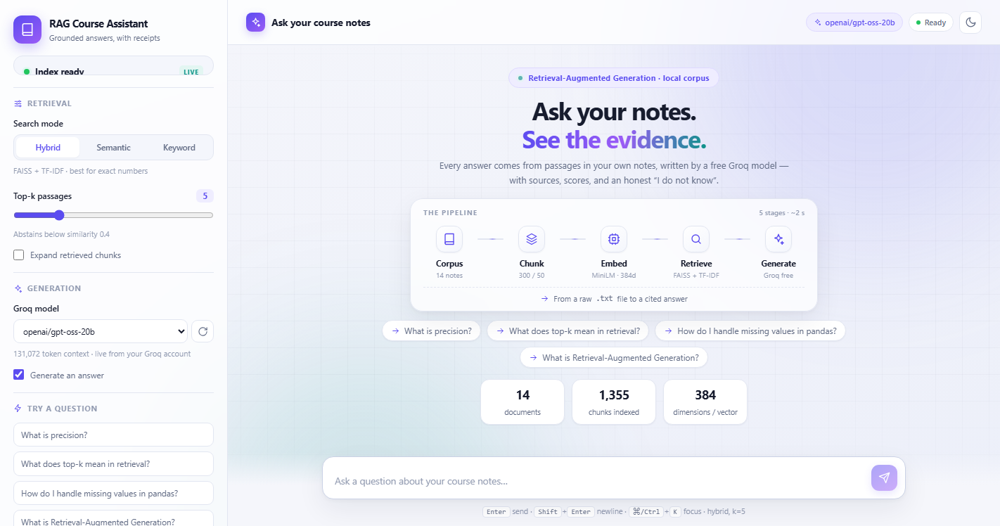
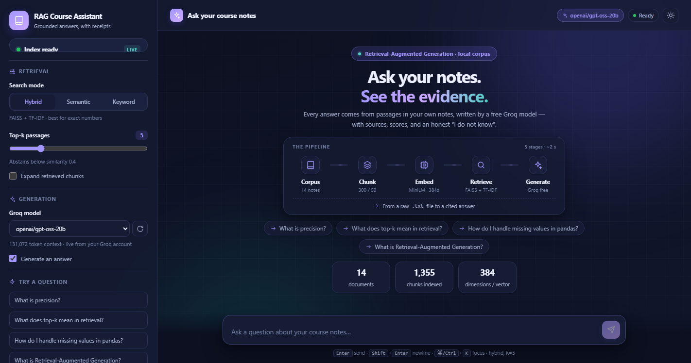
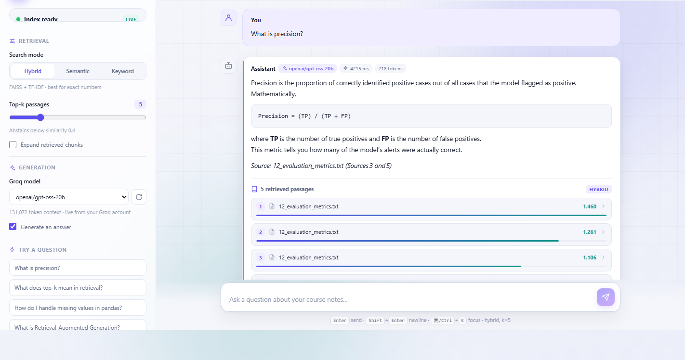
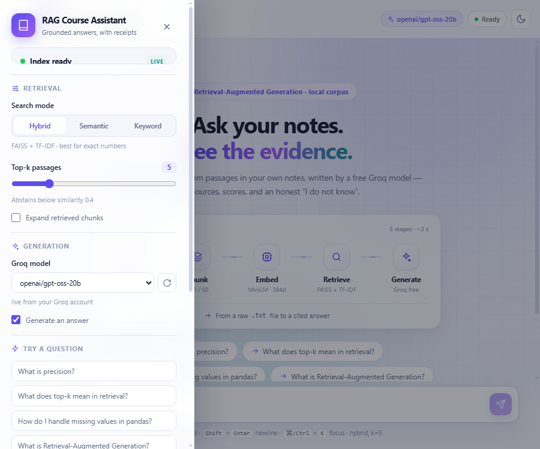

# RAG Course Assistant

A full-stack **RAG (Retrieval-Augmented Generation)** app built from the code in
`notebookaa73a1c9b8.ipynb`. The notebook's pipeline has been turned into a
FastAPI service, generation now runs on **Groq's free tier**, and a React UI lets
you chat with the corpus and inspect the exact passages behind every answer.

```
Local development                         Vercel deployment (single origin)
─────────────────                         ────────────────────────────────
Browser (React / Vite :5173)              Browser ──► https://YOUR-PROJECT.vercel.app
        │  /api proxy                              ├── /*      static Vite build
        ▼                                          └── /api/*  Python serverless functions
FastAPI (:8000) ──► RAGEngine                              │
        │              │                                   ├─ precomputed TF-IDF + BM25 index
        │              └─► FAISS + MiniLM                   │  (api/_index_data.py, built offline)
        │                   ▲                              │
        │                   │ 14 .txt files in ragg/        └──────► Groq chat.completions
        └──────────────► Groq chat.completions (free model)             (free model)
```

Two backends, **one REST contract**: the React app is unchanged. Locally you get
the full notebook pipeline (MiniLM embeddings + FAISS). On Vercel, a standard-
library-only serverless backend serves the same `/api/*` routes from a
precomputed index — no torch, no model download, no cold index build.
See **[DEPLOYMENT.md](DEPLOYMENT.md)**.

## Screenshots

<p align="center">
  
  
</p>
<p align="center">
  
  
</p>

Light and dark welcome screens, a grounded answer with its retrieved sources,
and the responsive sidebar drawer on a narrow window.

## What came from the notebook

| Notebook step | Where it lives now |
| --- | --- |
| Step 0b — load `*.txt` corpus | `rag_engine.load_corpus()` |
| Step 1a — recursive chunking (300 / 50) | `rag_engine.recursive_chunk()` |
| Step 2 — mean-pooled `all-MiniLM-L6-v2` (384-d) | `rag_engine.MiniLMEmbedder` |
| Step 3a — `IndexFlatIP` + L2 normalisation | `rag_engine.VectorIndex` |
| Step 3b — save / reload the index | `VectorIndex.save()/load()` + `rag_meta.json` cache |
| Step 4a — `retrieve(question, k)` | `RAGEngine.retrieve()` |
| Step 5 — grounded augmented prompt | `RAGEngine.build_prompt()` |
| Step 6 — generation (was local Qwen / DeepSeek) | `main._generate_with_groq()` → **Groq** |
| Step "Test honestly" — low score = don't know | `MIN_SCORE` abstain guard |
| Step 8 — TF-IDF + semantic hybrid search | `retrieve(mode="hybrid")` |

The notebook's `rag_course_docs` folder is this repo's `ragg/` folder (configurable
with `CORPUS_DIR`). The notebook file itself is kept as the source reference.

## Prerequisites

- Python 3.10+ (developed on 3.13) and Node 18+ (developed on 22)
- A free Groq API key: <https://console.groq.com/keys>
- Internet on the **first local backend run** — Hugging Face downloads
  `all-MiniLM-L6-v2` (~90 MB, then cached). No Hugging Face token is needed for
  this public model. The Vercel serverless backend needs no model download at all.

## Quick start

**1. Configure**

```bash
cp .env.example .env
# edit .env and paste your own Groq key into GROQ_API_KEY
```

`GROQ_MODEL` defaults to `openai/gpt-oss-20b`, a free-tier chat model. Groq
retires model IDs fairly often, so if you get a `model_not_found` error, check
which models are active for your key:

```bash
curl https://api.groq.com/openai/v1/models \
  -H "Authorization: Bearer $GROQ_API_KEY"
```

Active alternatives include `openai/gpt-oss-120b`, `qwen/qwen3.8-27b`, and
`allam-2-7b`. Keep `MAX_TOKENS` at 800 by default — some free-tier models cap
output tokens per minute at 1000. The backend uses `max_completion_tokens`
(the current parameter name) and reports `reasoning_tokens` in the API response.

**2. Backend**

```bash
python -m venv .venv
# Windows: .venv\Scripts\activate    |    macOS/Linux: source .venv/bin/activate
pip install -r backend/requirements.txt
uvicorn backend.main:app --reload --port 8000
```

The server starts immediately and builds the index on a background thread.
The first build embeds ~1,300 chunks and can take a few minutes; the React UI
shows the progress. Later starts load `backend/storage/rag.index` instantly.
API docs: <http://127.0.0.1:8000/docs>

**3. Frontend** (second terminal)

```bash
cd frontend
npm install
npm run dev
```

Open <http://localhost:5173>.

> If `faiss-cpu` has no wheel on your platform, delete that one line from
> `backend/requirements.txt`. The engine automatically falls back to an exact
> NumPy cosine search — same results, just no on-disk FAISS index.

## Deploying to Vercel

**One Vercel project hosts the entire app** — frontend *and* backend. Import
this repo with Root Directory `./`, add `GROQ_API_KEY` in the project's
Environment Variables, and deploy. Leave `VITE_API_BASE_URL` **empty**: `/api`
is served same-origin by the Python functions in `api/`.

```
vercel.json  ──►  npm --prefix frontend ci
             ──►  npm --prefix frontend run build  ──►  frontend/dist (static)
             └─►  api/*.py  ──►  /api/health, /api/status, /api/documents,
                                  /api/models, /api/ask, /api/search, /api/reindex
```

The Vercel backend uses the Python standard library only. `ragg/*.txt` is
chunked, TF-IDF weighted and inverted-indexed **offline** by
`scripts/build_serverless_index.py` into `api/_index_data.py` (≈294 KiB), which
is committed. At request time the functions score with TF-IDF cosine + BM25 and
call Groq over HTTPS. No `requirements.txt`, no pip install, no model weights,
no writable disk.

| | Local FastAPI | Vercel serverless |
| --- | --- | --- |
| Runtime | Uvicorn, Python 3.10+ | Vercel Python 3.12 |
| Dependencies | torch, transformers, faiss-cpu, sklearn, groq | **stdlib only** |
| Retrieval | MiniLM cosine + FAISS + TF-IDF | TF-IDF cosine + BM25 + coverage confidence |
| Chunks | 1,355 | 1,277 (tiny fragments merged) |
| `MIN_SCORE` | 0.4 | 0.12 (calibrated) |
| Cold start | minutes (first index build) | milliseconds |

After editing `ragg/`, regenerate and commit the index:

```bash
python scripts/build_serverless_index.py
python scripts/test_serverless.py       # 55 offline checks, no server needed
python scripts/calibrate_serverless.py  # check the abstain threshold
git add api/_index_data.py ragg/ && git commit -m "Refresh serverless index" && git push
```

The `Dockerfile` remains available if you want the full MiniLM/FAISS FastAPI
service on a separate container host instead; that path is optional.

See **[DEPLOYMENT.md](DEPLOYMENT.md)** for the step-by-step guide, verification
curl commands, corpus-update workflow and troubleshooting table.

## API

These routes are identical on both backends. On Vercel each one is a separate
file in `api/` (`api/status.py` → `/api/status`, and so on).

| Method | Path | Purpose |
| --- | --- | --- |
| `GET` | `/api/health` | liveness probe |
| `GET` | `/api/status` | build state, corpus stats, active model, defaults |
| `GET` | `/api/documents` | files in the corpus with character counts |
| `GET` | `/api/models` | chat models active for your Groq key (cached 5 min; `?refresh=true` to bypass) |
| `POST` | `/api/ask` | retrieve + grounded Groq answer |
| `POST` | `/api/search` | retrieval only — **no API key needed** |
| `POST` | `/api/reindex` | force a rebuild (e.g. after editing `ragg/*.txt`) |

```bash
curl -X POST http://127.0.0.1:8000/api/ask \
  -H "Content-Type: application/json" \
  -d '{"question":"What is precision?","k":5,"mode":"hybrid"}'
```

`mode` is `hybrid`, `semantic`, or `keyword`. Locally that means FAISS cosine +
TF-IDF, FAISS only, or TF-IDF only; on Vercel it means TF-IDF cosine + BM25,
TF-IDF cosine only, or BM25 only. The UI relabels the hints automatically based
on the `runtime` field in `/api/status`. Set `use_llm: false` for retrieval-only
debugging. Pass an optional `model` to override `GROQ_MODEL` for a single
request — that is how the UI's model picker works, with no restart needed.

Pass `extra_docs` (a list of `{source, text}` objects) to include your own
documents in retrieval alongside the baked corpus. User-supplied chunks are
scored with the same TF-IDF/MiniLM strategy and merged with corpus hits, so a
matching note can surface in the top-k sources. Max 10 docs, 50 KB each:

```bash
curl -X POST http://127.0.0.1:8000/api/ask \
  -H "Content-Type: application/json" \
  -d '{"question":"What is the F1 score?","extra_docs":[{"source":"my-note.txt","text":"F1 = 2 * (precision * recall) / (precision + recall)"}]}'
```

## Controls in the UI

- **Pipeline diagram** — the five RAG stages on the welcome screen, with a pulse
  that travels along them while a question is being answered.
- **Model picker** — lists the chat models actually active for your key (fetched
  from `/api/models`), so a retired model ID never leaves you stuck. The refresh
  button re-queries Groq.
- **Light / dark theme** — toggle in the sidebar or topbar; the choice persists
  in `localStorage`.
- **Markdown answers** — bold, lists, tables, code and math render properly;
  LaTeX from reasoning models is converted into readable formula blocks, and
  glued citations like `emails).[Source 3]` are spaced for readability.
- **Responsive layout** — vertical spacing tightens on short laptop screens so
  the pipeline, examples and stats stay above the composer; new answers scroll
  to the start of the exchange rather than past their own opening line.
- **Source cards** — per-hit score bars plus semantic/keyword scores, expandable
  chunk text, and a one-click copy button.
- **Search mode / top-k** — change retrieval live, no restart.
- **Generate an answer** — off = retrieval only, useful when you have no key.
- **My notes** — add your own `.txt`/`.md` files or paste text directly in the
  sidebar. Notes are stored in `localStorage` (per-browser) and sent with each
  question as `extra_docs`, so they're chunked and scored alongside the baked
  corpus at request time. A user note that matches the question can outrank
  corpus passages and appear in the sources list. Up to 10 documents,
  50 KB each, 200 KB total. Works on Vercel immediately — no storage, no
  credentials, no redeploy.
- **Rebuild index** — re-chunk and re-embed after editing the corpus. Adding or
  editing a `.txt` file invalidates the cache automatically via a content hash.
- **Shortcuts** — `Enter` send, `Shift+Enter` newline, `⌘/Ctrl+K` focus the box,
  `Esc` close the sidebar drawer on narrow screens.
- **Narrow windows** — below 1000px the sidebar becomes a drawer behind the
  hamburger button; click the dimmed area to its right or press `Esc` to close.
  The drawer stays above the backdrop so its controls and scrolling keep working.
  If Groq's model list is unreachable, the picker falls back to the server's
  configured `GROQ_MODEL` instead of staying disabled.
- **"What is LangChain?"** is an intentional out-of-corpus question: the top
  similarity should drop below `MIN_SCORE` and the assistant should abstain.

## Key settings

| Variable | Default | Meaning |
| --- | --- | --- |
| `GROQ_API_KEY` | — | your free Groq key |
| `GROQ_MODEL` | `openai/gpt-oss-20b` | active free-tier chat model |
| `MAX_TOKENS` | `800` | output budget (includes reasoning tokens) |
| `CORPUS_DIR` | `./ragg` | folder of `.txt` documents |
| `CHUNK_SIZE` / `CHUNK_OVERLAP` | `300` / `50` | recursive chunking |
| `DEFAULT_K` | `5` | passages sent to the model |
| `MIN_SCORE` | `0.4` local / `0.12` serverless | abstain threshold; the two retrieval scales differ |
| `ABSTAIN_GUARD` | `true` | skip Groq when confidence is low |
| `TEMPERATURE` | `0.2` | low = stick to context |

All paths in `.env` are resolved relative to the project root, not the shell's
current directory.

## Troubleshooting

- **`GROQ_API_KEY is not set`** — create `.env` at the repo root; the backend
  loads it at startup. Turn off "Generate with Groq" to use retrieval only.
- **`model_not_found` / 404** — Groq retired that model ID. Query
  `GET /openai/v1/models` with your key and set `GROQ_MODEL` to an active one.
- **429 "output tokens per minute"** — lower `MAX_TOKENS` (e.g. to `600`) or
  switch to a model with a higher cap; some free-tier models allow only 1000.
- **Still "Building index…"** — first run downloads the embedding model. Watch
  the backend terminal; `GET /api/status` reports an error if the download fails.
- **`faiss` import fails** — the NumPy fallback kicks in automatically; check
  `vector_backend` in `/api/status`.
- **CORS error** — make sure the frontend runs on port 5173, or add your origin
  to `ALLOWED_ORIGINS`.
- **`ModuleNotFoundError` on Windows** — this machine has two Python 3.13 installs.
  The `python` on PATH is a WorkBuddy-bundled interpreter with no project packages;
  the system one is `py -3.13` (`AppData\Local\Programs\Python\Python313\python.exe`).
  Use the same interpreter for `pip install` and `uvicorn`, or activate your venv.
- **Answers seem to miss the right passage** — raise `k`, switch to `hybrid`
  search (exact numbers are hard for semantic search alone), or lower `MIN_SCORE`.
  The prompt itself explicitly forbids outside knowledge.

## Security note

`.env`, `backend/storage/`, `node_modules/`, and `.workbuddy-ai/` are gitignored.
Never commit `GROQ_API_KEY` — on Vercel it belongs in Environment Variables.
`api/_index_data.py` contains only the corpus text and its precomputed TF-IDF
weights (no secrets) and **is** committed so the functions can read it.
Generated answers are grounded in the local `.txt` corpus and are not stored
anywhere by the app.

## Project layout

| Path | Role |
| --- | --- |
| `backend/` | local FastAPI service: MiniLM + FAISS + Groq |
| `api/` | Vercel Python functions; each route defines a top-level `class handler` so Vercel detects it, `_`-prefixed files are shared helpers |
| `scripts/` | offline index builder, calibration and 55 endpoint/entrypoint checks |
| `ragg/` | the 14 `.txt` course notes (the notebook's corpus) |
| `frontend/` | React + Vite UI |
| `vercel.json` | Vite build settings only — no `functions` block to trip `unused_function` |
| `.vercelignore` | keeps `backend/`, `ragg/`, `docs/`, `scripts/` and other bulk out of the deployment |
| `Dockerfile` | optional separate host for the full FastAPI backend |
